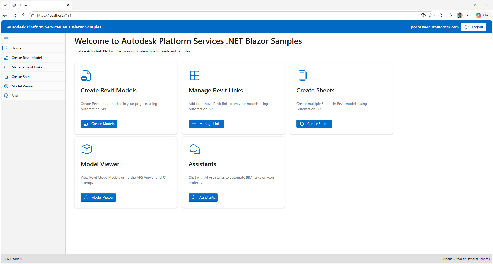

# Autodesk Platform Services .NET Blazor Samples


[](http://developer.autodesk.com/)
[](http://autodesk.com/revit)
[](https://dotnet.microsoft.com/)
[](https://docs.microsoft.com/en-us/dotnet/csharp/)
[](https://opensource.org/licenses/MIT)

---

A Blazor Server web application demonstrating how to use [Autodesk Platform Services (APS)](https://aps.autodesk.com/) with .NET 10. The sample showcases six key capabilities powered by the **APS Automation API**, **Data Management API**, **Forma APIs**, **Webhooks API**, **AEC Data Model API**, and **AI-powered assistants**:

- **Create Revit Models**–Programmatically create Revit cloud models inside Forma for Construction projects.
- **Manage Revit Links**–Add or remove Revit links between models using a visual link matrix. Uses Autodesk Forma APIs to query linked-file relationships alongside the Automation API.
- **Create Sheets**–Batch-create sheets in Revit cloud models.
- **Model Viewer**–Select a Revit cloud model and render it interactively in the browser using the APS Viewer with Blazor JavaScript Interoperability.
- **Revit Webhooks**–Get notified when Revit links are added to or removed from a Revit cloud model, using Webhooks and the AEC Data Model API. See [Revit Webhooks](#revit-webhooks).
- **Assistants**–Chat with role-based AI assistants that act on the project as their own service accounts, with tools for Revit models, folders, project users, issues and delegation. See the [Assistants page](docs/assistants.md) for setup, tools and limitations.

The app uses 3-legged OAuth to authenticate users via their Autodesk account. After sign-in, each user picks one Forma for Construction hub and project, which every workflow then uses. Users can configure automation jobs and track their status.



---

> **⚠️ Disclaimer**  
> This is a **vibe-coded sample solution** - an exploratory proof-of-concept developed iteratively. It demonstrates patterns and possibilities but may not follow all production-grade practices. This README was generated by **GitHub Copilot** based on analyzing the actual codebase, ensuring documentation matches implementation.

---

## Usage

1. Sign in with your Autodesk account with the **Sign In** button in the header or on the `/signin` page.
2. Pick a hub and project at `/projects`. The list shows only ACC projects in US-region hubs, and hides projects whose name contains "Component Library". Your choice is saved per user, and every workflow uses it. To switch, use **Change Project** in the header.
3. Choose one of the six workflows from the home page cards:
   - **Create Revit Models**–pick a target folder, then choose a template model, fill in the model names (using the folder's naming standard when it has one), and submit.
   - **Manage Revit Links**–the link matrix between the project's models loads automatically. Change the links you want and apply them.
   - **Create Sheets**–pick a Revit model, enter a title block template name, define the sheets, and submit.
   - **Model Viewer**–pick an `.rvt` model from the dropdown to render it in the APS Viewer. Models whose name contains "template" aren't listed.
   - **Revit Webhooks**–subscribe to link changes on a Revit cloud model. See [Revit Webhooks](#revit-webhooks).
   - **Assistants**–chat with the assistants for your project roles. See the [Assistants page](docs/assistants.md).
4. Project administrators also see a **Settings** card, where they configure the project's assistants.
5. Track Create Revit Models, Manage Revit Links and Create Sheets jobs on their tracking pages: `/{ProjectId}/model-creation-tracking`, `/{ProjectId}/revit-links-change-tracking` and `/{ProjectId}/sheet-creation-tracking`. These pages poll the job status on a timer, so updates aren't real time. **Model Viewer** is read-only and has no tracking page.

https://github.com/user-attachments/assets/8d185426-96b4-4d91-8dba-1b3a168ee8ce

---

## Development

### Prerequisites

- [Autodesk Platform Services app credentials](https://aps.autodesk.com/myapps/) (Client ID & Client Secret) for an app that can use the following APIs:
  - Data Management API
  - Forma for Construction API
  - Automation API
  - Model Derivative API
  - Webhooks API
  - AEC Data Model API
  - ACC Account Admin API
  - ACC Issues API
  - Secure Service Accounts API

  See the [APS documentation](https://aps.autodesk.com/developer/documentation) for each API.
- A provisioned **Forma for Construction** account with at least one hub and project
- **Automation Activity** deployed for [APS Automation API Revit MCP Tools Sample](https://github.com/autodesk-platform-services/aps-automation-api-revit-mcp-tools-sample)
- [.NET 10 SDK](https://dotnet.microsoft.com/en-us/download/dotnet/10.0)
- A valid **Callback URL** registered on your APS app (e.g. `https://localhost:7191/api/auth/callback`). The launch profiles use `https://localhost:7191` and `http://localhost:5271`.
- **[Ollama](https://ollama.com/)** installed and running locally (or accessible remote endpoint) with a language model that supports function calling (e.g., `llama3.1:8b`)
- **[ngrok](https://ngrok.com/)** (or a similar tunneling tool) to expose two webhook endpoints: the Data Management webhook (`/api/webhooks/version-added`) used for assistant publish tracking, and the Revit Webhooks callback (`/api/revit-webhooks`)

> **Note (Assistants):** Creating assistants requires the Project Administrator access level on the selected project. Users chat only with the assistants created for their own project roles. The LLM must support function calling for the assistant's tools to work properly.

### Assistants

Assistants are role-based AI assistants that chat with project members and act on the project through tools for Revit models, folders, project users, issues and delegation. Each assistant acts as its own service account, so ACC records the assistant as the author of its changes. Project administrators create them under **Settings → Assistants**, and the feature needs a running Ollama instance with a function-calling model. See the [Assistants page](docs/assistants.md) for setup, tools and limitations.

> **⚠️ Security:** `Data/ssa-apps.json` (APS app client secrets) and `Data/ssa-keys.json` (service account private keys) are stored in **plaintext**. Protect the `Data/` directory on any host that runs the sample.

---

### Steps to build and run the sample locally

1. **Clone the repository**

   ```bash
   git clone https://github.com/autodesk-platform-services/aps-dotnet-blazor-samples.git
   cd aps-dotnet-blazor-samples
   ```

2. **Configure app settings**

   Open `appsettings.json` (or use [.NET User Secrets](https://learn.microsoft.com/en-us/aspnet/core/security/app-secrets)) and fill in your credentials:

   ```json
   {
     "Forge": {
       "ClientId": "<your-client-id>",
       "ClientSecret": "<your-client-secret>",
       "CallbackUrl": "https://localhost:<port>/api/auth/callback",
       "RevitAutomationActivity": "<your-activity-alias>"
     },
     "Agent": {
       "ModelName": "llama3.1:8b",
       "OllamaEndpoint": "http://localhost:11434",
       "MaxToolIterations": 10
     },
     "Webhooks": {
       "CallbackUrl": "<ngrok-url>/api/webhooks/version-added"
     },
     "RevitWebhooks": {
       "CallbackBaseUrl": "<ngrok-url>/api/revit-webhooks"
     }
   }
   ```

   The `Agent` keys configure the assistants' model:

   | Key | Code default | Notes |
   | --- | --- | --- |
   | `Agent:ModelName` | `llama3` | Must be set. The shipped `appsettings.json` has an empty string, which overrides the code default. |
   | `Agent:OllamaEndpoint` | `http://localhost:11434` | Must be set. The shipped empty string overrides the code default, and the chat client can't start without an endpoint. |
   | `Agent:MaxToolIterations` | `10` | Optional. Limits how many rounds of tool calls an assistant can make for a single request. |

   Using User Secrets (recommended):

   ```bash
   dotnet user-secrets set "Forge:ClientId" "<your-client-id>"
   dotnet user-secrets set "Forge:ClientSecret" "<your-client-secret>"
   dotnet user-secrets set "Forge:CallbackUrl" "https://localhost:<port>/api/auth/callback"
   dotnet user-secrets set "Forge:RevitAutomationActivity" "<your-activity-alias>"
   dotnet user-secrets set "Agent:ModelName" "llama3.1:8b"
   dotnet user-secrets set "Agent:OllamaEndpoint" "http://localhost:11434"
   dotnet user-secrets set "Agent:MaxToolIterations" "10"
   dotnet user-secrets set "Webhooks:CallbackUrl" "<ngrok-url>/api/webhooks/version-added"
   dotnet user-secrets set "RevitWebhooks:CallbackBaseUrl" "<ngrok-url>/api/revit-webhooks"
   ```

3. **Run the application**

   ```bash
   dotnet run
   ```

   `dotnet run` uses the first launch profile, `http`, at `http://localhost:5271`. To serve `https://localhost:7191` as well, run `dotnet run --launch-profile https`. Open that URL in your browser, and register the matching callback URL on your APS app.

### Running the tests

The `ApsSamples.Tests` project holds xUnit tests. Run them from the repository root:

```bash
dotnet test
```

---

### Revit Webhooks

The **Revit Webhooks** page at `/revit-webhooks` subscribes to a Revit cloud worksharing model and reports when Revit links are added or removed (`LinkAdded` and `LinkRemoved` events). It listens for the model's publish or sync events, then reads the model's links through the AEC Data Model API to find what changed.

- Set `RevitWebhooks:CallbackBaseUrl` to your public URL followed by `/api/revit-webhooks`. The app appends `/model-publish` or `/model-sync` for each subscription, so the URL must be reachable by APS (for example, through ngrok).
- Subscriptions and their event log are stored in `Data/revit-webhook-subscriptions.json` and `Data/revit-webhook-events.json`. Like the other files in `Data/`, this is a demo-only file store.
- The `/api/revit-webhooks/demo-receiver` endpoint only logs the payload it receives, so you can try a subscription without an external receiver.

### Deployment

When deploying to a hosting environment (e.g. Azure App Service):

- Set the `Forge:*`, `Agent:*`, `Webhooks:*`, and `RevitWebhooks:*` configuration values as environment variables or application settings.
- Ensure the **Callback URL** registered on your APS app matches the deployed URL.
- Configure the `Webhooks:CallbackUrl` to point to your deployed application's webhook endpoint (no longer using ngrok in production).
- Set `RevitWebhooks:CallbackBaseUrl` to your deployed URL followed by `/api/revit-webhooks`.
- Automation API workitems use ngrok-style HTTP callbacks on the `/da` path — configure any reverse proxy to pass that path through without HTTPS redirection.
- The `GET /api/auth/viewer-token` endpoint is called from the browser by the APS Viewer and must be reachable over HTTPS on the deployed origin.

### Known limitations

- Job status for Create Revit Models, Manage Revit Links, and Create Sheets is stored in-memory; restarting the application clears pending job history.
- AI Assistants conversations and tasks are persisted to JSON files in the `Data/` directory (`agent-conversations.json`, `agent-tasks.json`). This is a **demo-only file store** — all data is lost if the files are deleted, and it is not suitable for concurrent multi-user production deployments. Production forks should replace `AgentConversationService` with a database-backed implementation.
- In the AI Assistants feature, users see the assistants configured for their project roles. Assistants are configured by Project Administrators under **Settings → Assistants**.
- Each APS app can own at most 10 assistant service accounts. Add more APS apps to a project under **Settings → Assistants** to create more assistants. APS app secrets are stored in plaintext in `Data/ssa-apps.json`.
- AI Assistants can't delete issues, delete or rename folders, manage folder permissions, or remove project users.
- The delegation queue is in memory. After a restart, pending delegated tasks are queued again and tasks that were running are marked failed ("Interrupted by an app restart."), so their work is not silently repeated. At most two delegated tasks run at once, each limited to 30 minutes. Multi-step delegation depends on how well the local model calls tools.
- The Automation API activity must already exist and be published before running the sample.
- Ollama must be running and accessible for the AI Assistants feature to function.

### Additional resources

- [Autodesk Platform Services documentation](https://aps.autodesk.com/developer/documentation)
- [Automation API](https://aps.autodesk.com/en/docs/design-automation/v3/developers_guide/overview/)
- [Data Management API](https://aps.autodesk.com/en/docs/data/v2/developers_guide/overview/)
- [Model Derivative API](https://aps.autodesk.com/en/docs/model-derivative/v2/developers_guide/overview/)
- [APS Viewer](https://aps.autodesk.com/en/docs/viewer/v7/developers_guide/overview/)
- [Microsoft.Extensions.AI](https://devblogs.microsoft.com/dotnet/introducing-microsoft-extensions-ai-preview/)
- [Ollama](https://ollama.com/)

---

## License

This sample is licensed under the terms of the [MIT License](LICENSE). Please see the [LICENSE](LICENSE) file for full details.
