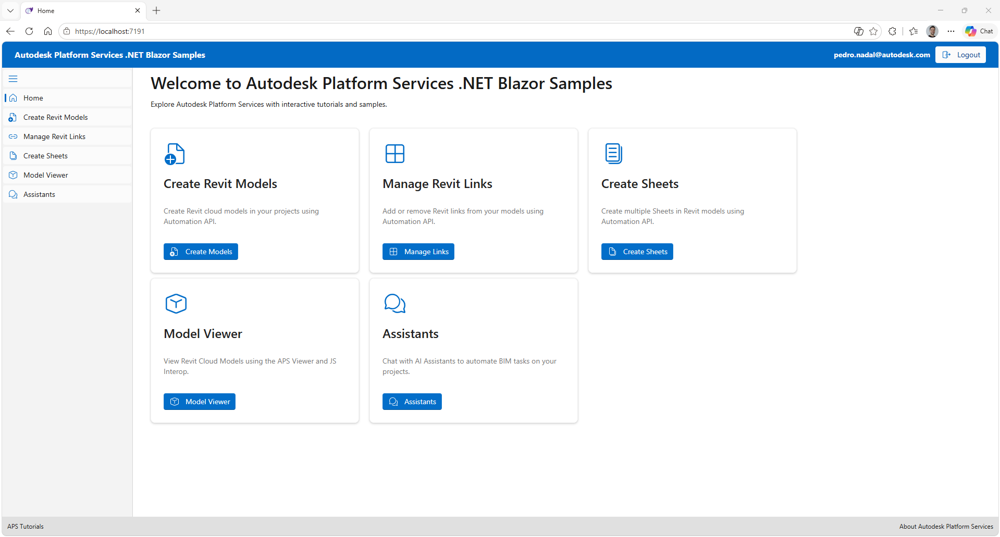

# Autodesk Platform Services .NET Blazor Samples


[](http://developer.autodesk.com/)
[](http://autodesk.com/revit)
[](https://dotnet.microsoft.com/)
[](https://docs.microsoft.com/en-us/dotnet/csharp/)
[](https://opensource.org/licenses/MIT)

---

A Blazor Server web application demonstrating how to use [Autodesk Platform Services (APS)](https://aps.autodesk.com/) with .NET 10. The sample showcases five key capabilities powered by the **APS Automation API**, **Data Management API**, **Forma APIs**, and **AI-powered assistants**:

- **Create Revit Models** – Programmatically create Revit cloud models inside Forma for Construction) projects.
- **Manage Revit Links** – Add or remove Revit links between models using a visual link matrix. Uses Autodesk Forma APIs to query linked-file relationships alongside the Automation API.
- **Create Sheets** – Batch-create sheets in Revit cloud models.
- **View Models** – Select a Revit cloud model and render it interactively in the browser using the APS Viewer with Blazor JavaScript Interoperability.
- **AI Assistants** – Chat with role-based AI assistants (one assistant per Forma project role) to automate Revit model management tasks. Pick an assistant when starting a conversation and `@mention` another assistant to bring it into the conversation. Project admins create one assistant per project role and choose which tool modules it can use: **Revit Models**, **Folders**, **Project Users**, **Issues** and **Delegation** (hand tasks to other assistants). Uses Microsoft.Extensions.AI with function calling for tool integration and real-time task tracking.

The app uses 3-legged OAuth to authenticate users via their Autodesk account, then lets them browse their hubs of Forma for Construction and projects through a folder explorer, configure automation jobs, and track their real-time status.



---

> **⚠️ Disclaimer**  
> This is a **vibe-coded sample solution** - an exploratory proof-of-concept developed iteratively. It demonstrates patterns and possibilities but may not follow all production-grade practices. This README was generated by **GitHub Copilot** based on analyzing the actual codebase, ensuring documentation matches implementation.

---

## Usage

1. Sign in with your Autodesk account via the **Sign In** button on the home page.
2. Choose one of the five workflows from the home page cards:
   - **Create Revit Models** – select a project and target folder, fill in the model configuration, and submit.
   - **Manage Revit Links** – select a project, build a link matrix between models, and apply it.
   - **Create Sheets** – select a project and Revit model, define the sheet list, and submit.
   - **View Models** – select a project, then select a .rvt model from the list to render it in the APS Viewer.
   - **AI Assistants** – select a project, start a conversation with one of the assistants available for your project roles (or continue an existing one), `@mention` another assistant (e.g. `@bimmanagerassistant`) to route a message to it, and interact through natural language using the tools the assistant was given (grouped by module).
3. For the automation workflows (Create Revit Models, Manage Revit Links, Create Sheets, and AI Assistants), track job progress on the corresponding tracking page or task panel; results are updated in real time. **View Models** is read-only and has no tracking page.

https://github.com/user-attachments/assets/8d185426-96b4-4d91-8dba-1b3a168ee8ce

---

## Development

### Prerequisites

- [Autodesk Platform Services app credentials](https://aps.autodesk.com/myapps/) (Client ID & Client Secret) with the following APIs enabled:
  - Data Management API
  - Forma for Construction API
  - Automation API
  - Model Derivative API
- A provisioned **Forma for Construction** account with at least one hub and project
- **Automation Activity** deployed for [APS Automation API Revit MCP Tools Sample](https://github.com/autodesk-platform-services/aps-automation-api-revit-mcp-tools-sample)
- [.NET 10 SDK](https://dotnet.microsoft.com/en-us/download/dotnet/10.0)
- A valid **Callback URL** registered on your APS app (e.g. `https://localhost:7000/api/auth/callback`)
- **[Ollama](https://ollama.com/)** installed and running locally (or accessible remote endpoint) with a language model that supports function calling (e.g., `llama3.1:8b`)
- **[ngrok](https://ngrok.com/)** (or similar tunneling tool) for exposing webhook endpoints to receive publish completion callbacks

> **Note (AI Assistants):** Creating assistants requires the Project Admin role on the selected project. Users chat only with the assistants created for their own project roles. The LLM must support function calling for the assistant's tools to work properly.

#### Agent tool modules

Every agent action runs as the agent's own **service account** (SSA), which is created and added to the project when the agent is created, so ACC records the agent, not the signed-in user, as the author of its changes. Some modules need extra setup:

- **Revit Models** – listing and publishing need the service account to have access to the project folders. Linked Revit files are returned only for models published after 2025-02-07, and only links the service account can download.
- **Folders** – new folders are created under "Project Files" unless a parent folder is given. The service account needs Edit or Manage permission on the parent folder. Existing folders are reused, so repeating a request does not create duplicates.
- **Project Users** – hub user search uses a 2-legged token with `account:read`, so the APS app must be provisioned as a **custom integration** in the ACC account. Adding users and changing their role or company needs the agent's service account to have **project admin** access (grant it the Project Administration product).
- **Issues** – using Issues through a service account needs a **Forma Build** subscription on that service account. The ACC Issues API has no delete: agents can close an issue by setting its status to `closed`, but deleting it must be done in the ACC UI.
- **Delegation** – an assistant with these tools (for example the BIM Manager assistant) can list the other assistants in the project and hand tasks to them. Delegation is asynchronous: the assistant replies at once, and each delegate runs the task in the background as itself, with its own service account and its own enabled tools. Delegates can't delegate further. A task can depend on earlier delegated tasks in the same conversation; it waits until they complete and fails if one of them fails. Results and failures are posted in the originating conversation by the delegate and shown in the Tasks panel. Each delegate needs its own service account, project access, and the tool modules the task requires.

---

### Steps to build and run the sample locally

1. **Clone the repository**

   ```bash
   git clone https://github.com/autodesk-platform-services/aps-dotnet-blazor-samples.git
   cd aps-dotnet-blazor-samples
   ```

2. **Configure app settings**

   Open `appsettings.json` (or use [.NET User Secrets](https://learn.microsoft.com/en-us/aspnet/core/security/app-secrets)) and fill in your credentials:

   ```json
   {
     "Forge": {
       "ClientId": "<your-client-id>",
       "ClientSecret": "<your-client-secret>",
       "CallbackUrl": "https://localhost:<port>/api/auth/callback",
       "RevitAutomationActivity": "<your-activity-alias>"
     },
     "Agent": {
       "ModelName": "llama3.1:8b",
       "OllamaEndpoint": "http://localhost:11434",
       "MaxToolIterations": 10
     },
     "Webhooks": {
       "CallbackUrl": "<ngrok-url>/api/webhooks/version-added"
     }
   }
   ```

   `Agent:MaxToolIterations` (optional, default `10`) limits how many rounds of tool calls an assistant can make for a single request.

   Using User Secrets (recommended):

   ```bash
   dotnet user-secrets set "Forge:ClientId" "<your-client-id>"
   dotnet user-secrets set "Forge:ClientSecret" "<your-client-secret>"
   dotnet user-secrets set "Forge:CallbackUrl" "https://localhost:<port>/api/auth/callback"
   dotnet user-secrets set "Forge:RevitAutomationActivity" "<your-activity-alias>"
   dotnet user-secrets set "Agent:ModelName" "llama3.1:8b"
   dotnet user-secrets set "Agent:OllamaEndpoint" "http://localhost:11434"
   dotnet user-secrets set "Webhooks:CallbackUrl" "<ngrok-url>/api/webhooks/version-added"
   ```

3. **Run the application**

   ```bash
   dotnet run
   ```

   Navigate to `https://localhost:<port>` in your browser.

---

### Deployment

When deploying to a hosting environment (e.g. Azure App Service):

- Set the `Forge:*`, `Agent:*`, and `Webhooks:*` configuration values as environment variables or application settings.
- Ensure the **Callback URL** registered on your APS app matches the deployed URL.
- Configure the `Webhooks:CallbackUrl` to point to your deployed application's webhook endpoint (no longer using ngrok in production).
- Automation API workitems use ngrok-style HTTP callbacks on the `/da` path — configure any reverse proxy to pass that path through without HTTPS redirection.
- The `GET /api/auth/viewer-token` endpoint is called from the browser by the APS Viewer and must be reachable over HTTPS on the deployed origin.

### Known limitations

- Job status for Create Revit Models, Manage Revit Links, and Create Sheets is stored in-memory; restarting the application clears pending job history.
- AI Assistants conversations and tasks are persisted to JSON files in the `Data/` directory (`agent-conversations.json`, `agent-tasks.json`). This is a **demo-only file store** — all data is lost if the files are deleted, and it is not suitable for concurrent multi-user production deployments. Production forks should replace `AgentConversationService` with a database-backed implementation.
- In the AI Assistants feature, users see the assistants configured for their project roles. Assistants are configured by Project Administrators under **Settings → Assistants**.
- AI Assistants can't delete issues, delete or rename folders, manage folder permissions, or remove project users.
- The delegation queue is in memory. After a restart, pending delegated tasks are queued again and tasks that were running are marked failed ("Interrupted by an app restart."), so their work is not silently repeated. At most two delegated tasks run at once, each limited to 30 minutes. Multi-step delegation depends on how well the local model calls tools.
- The Automation API activity must already exist and be published before running the sample.
- Ollama must be running and accessible for the AI Assistants feature to function.

### Additional resources

- [Autodesk Platform Services documentation](https://aps.autodesk.com/developer/documentation)
- [Automation API](https://aps.autodesk.com/en/docs/design-automation/v3/developers_guide/overview/)
- [Data Management API](https://aps.autodesk.com/en/docs/data/v2/developers_guide/overview/)
- [Model Derivative API](https://aps.autodesk.com/en/docs/model-derivative/v2/developers_guide/overview/)
- [APS Viewer](https://aps.autodesk.com/en/docs/viewer/v7/developers_guide/overview/)
- [Microsoft.Extensions.AI](https://devblogs.microsoft.com/dotnet/introducing-microsoft-extensions-ai-preview/)
- [Ollama](https://ollama.com/)

---

## License

This sample is licensed under the terms of the [MIT License](LICENSE). Please see the [LICENSE](LICENSE) file for full details.
